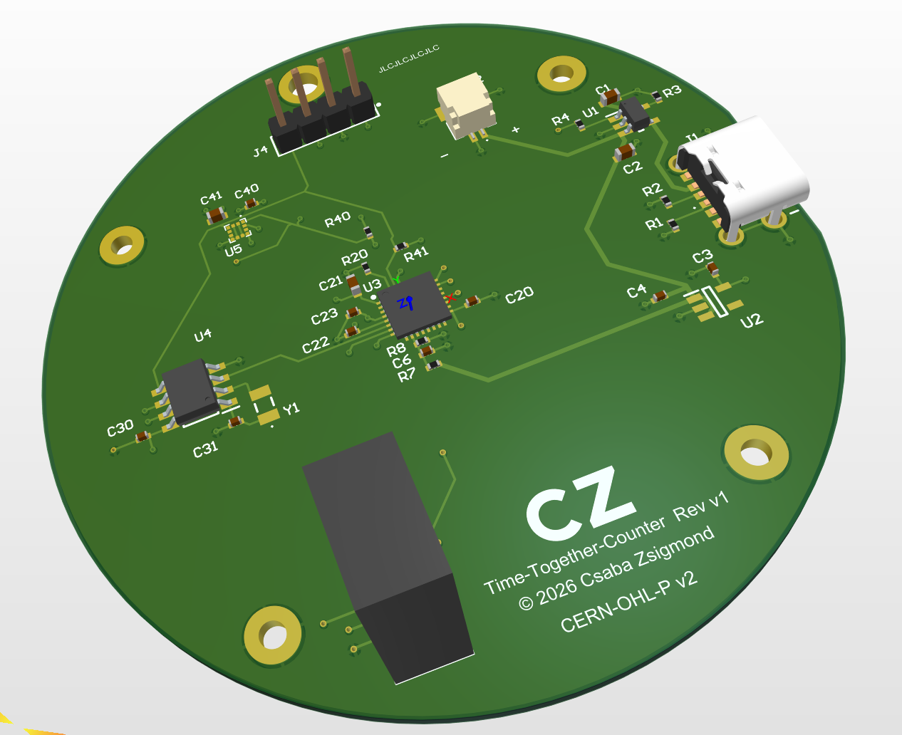

# Time-Counter

A 68 mm circular PCB that displays elapsed time from a fixed date in `YY:DDD:HH:MM:SS` format. The 1.3" OLED stays off until double-tapped, running standalone on a small LiPo charged over USB-C.

Designed in Altium Designer by Zsigmond Csaba.



> [!TIP]
> **Schematic and PCB layout:** no Altium needed. Open the PDFs in the [`docs`](docs/) folder:
> - 📄 [Schematic (PDF)](docs/schematic.pdf)
> - 📄 [PCB layout (PDF)](docs/layout.pdf)
> - 📋 [Bill of materials (CSV)](docs/BOM.csv)

## How it works

The STM32 sleeps until the accelerometer triggers a hardware double/triple-tap or any tipe of mechanical interrupt. On wake, it reads the RTC, calculates elapsed time, displays it on the OLED for ~5 seconds, and returns to sleep.

| Block | Part | Notes |
| --- | --- | --- |
| MCU | STM32L031K6U6 | ~1 µA in Stop mode, programmed over SWD (TC2030) |
| Real-time clock | BM8563ESA | 32.768 kHz, Q13FC13500004 | theoratical maximum inaccuracy is estimated 10 minutes /year
| Wake on double-tap | ST LIS2DW12 | Tap detection in hardware, INT1 wakes the MCU |
| Display | 1.3" 128×64 SH1106 I²C OLED module | Always on 3V3, put to sleep between taps |
| Charger | Microchip MCP73831 (4.2 V) | 100 mA charge current, status read by the MCU |
| Regulator | TI TPS7A0233 (3.3 V) | 25 nA quiescent current |
| Battery | 502030 protected LiPo, ~250 mAh | JST SH 2-pin connector |
| Charging port | GCT USB4125-GF-A | USB-C, power only (5.1k CC pull-downs) |


### I²C addresses

| Device | Address |
| --- | --- |
| BM8563ESA | 0x51 |
| LIS2DW12 (accelerometer) | 0x18 |

## Repository layout

```
docs/                       SCHEMATIC, LAYOUT, 3D VIEW   
hardware/altium/            Altium project: .PrjPcb and .SchDoc
hardware/altium/libraries/  component libraries used by the project (.SchLib, .PcbLib)
hardware/production/        Gerbers, BOM and pick-and-place files (later)
firmware/                   STM32 firmware (later)
artwork/                    line art for the black art side of the board (later)
mechanical/                 3D-printed back cover (later)
```

## License

   Copyright 2026 Zsigmond Csaba

   This hardware design is licensed under the CERN Open Hardware Licence
   Version 2 – Permissive (CERN-OHL-P v2). See [LICENSE](LICENSE).
